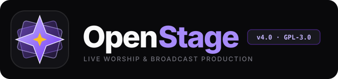
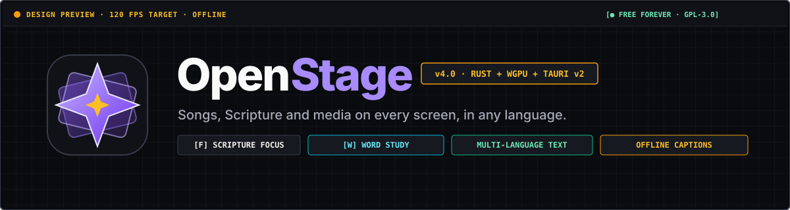
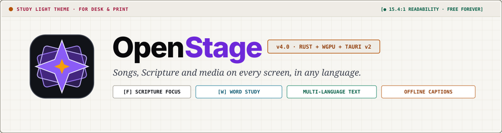
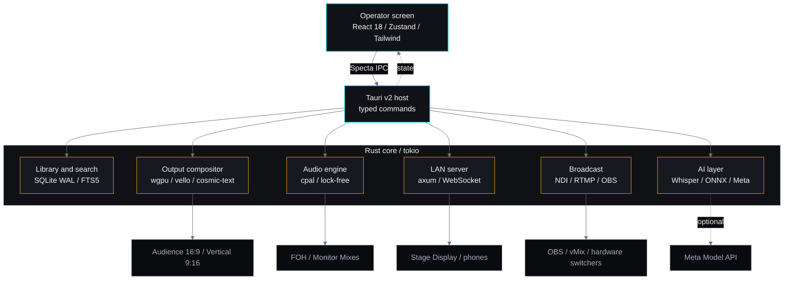
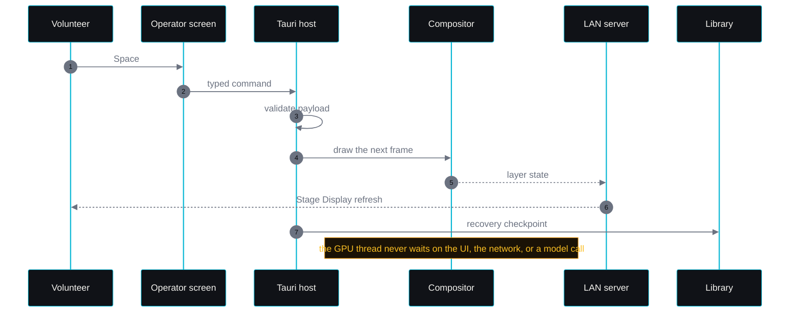
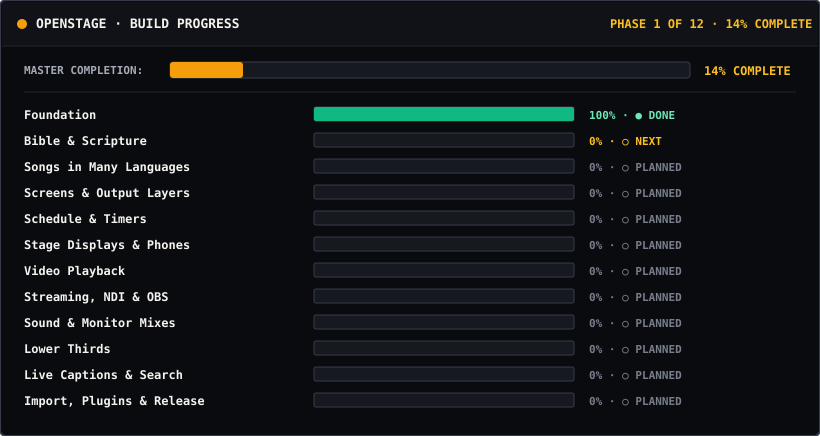

<a id="readme-top"></a>

<div align="center">

  <picture>
    <source media="(prefers-color-scheme: light)" srcset="assets/logos/logo-horizontal-light.svg">
    <source media="(prefers-color-scheme: dark)" srcset="assets/logos/logo-horizontal-dark.svg">
    
  </picture>

  <br /><br />

  

  <p>
    Free and open-source live production for the local church.<br />
    Built for the laptop you already have, and the volunteer running it.
  </p>

  <p>
    <a href="docs/meta/README.md"></a>
    <a href="https://www.gnu.org/licenses/gpl-3.0-standalone.html"></a>
    
  </p>

  <p>
    
    
    
    
    
    
    <!-- BUILD-PROGRESS-BADGE:START -->
    
    <!-- BUILD-PROGRESS-BADGE:END -->
  </p>

  <p>
    <a href="#why-openstage">Why</a> ·
    <a href="#what-it-does">Features</a> ·
    <a href="#meta-ai-layer">Meta AI</a> ·
    <a href="#design">Design</a> ·
    <a href="#engineering">Engineering</a> ·
    <a href="#quick-start">Quick Start</a> ·
    <a href="#project-status">Status</a> ·
    <a href="#documentation">Docs</a>
  </p>

</div>

```text
╭──────────────────────────────────────────────────────────────────────────╮
│  OPENSTAGE  ·  LIVE WORSHIP & BROADCAST PRODUCTION                       │
│  Rust · Tauri v2 · wgpu · HarfBuzz · Whisper · ONNX · GPL-3.0            │
╰──────────────────────────────────────────────────────────────────────────╯
```

> [!NOTE]
> **Early build.** The app doesn't start yet; the foundation is done and Scripture is next. [Project Status](#project-status) lists exactly what is in the repo.

---

## Why OpenStage

Most churches run the Sunday service on one modest machine, with a volunteer at the keyboard. Commercial presentation suites are expensive, heavy, and fragile. OpenStage is the free, offline alternative: one app to run, nothing to license, nothing that phones home.

| Dimension | Typical commercial suite | OpenStage v4.0 (target) |
| :--- | :--- | :--- |
| **License** | $300–$650 per year | **Free forever**, GPL-3.0 |
| **Memory** | 1.8–2.5 GB (Electron) | **Under 150 MB idle** |
| **Cold start** | 12–25 seconds | **Under 0.8 seconds** |
| **Offline** | License checks, cloud libraries | **Songs, Scripture and media work offline** |
| **Languages** | Text in many languages often clips or breaks | **Multi-Language Support** |
| **Screens** | Stage and NDI are often paid add-ons | **Audience 16:9, Vertical 9:16, NDI, phones** |
| **Sound** | Often needs virtual cables | **Built-in routing and monitor mixes** |
| **Setup** | Drivers, dongles, per-seat activation | **One installer, one app window** |

<sub>Representative figures for commercial and Electron-based suites. OpenStage targets are for an 8 GB laptop with integrated graphics; measured results will be published with each release.</sub>

---

## What It Does

Behavior for every feature below is specified in [`FEATURES.md`](FEATURES.md); [Project Status](#project-status) lists what is running today.

### For the Sunday Volunteer

- **Go Live, Black, Undo.** `Space` advances the service; `Esc` blacks the screen; the **Undo** button brings it back for ten seconds.
- **Typing protection.** Shortcuts pause while you type in a search box, so nothing jumps live by accident.
- **Mode: Volunteer.** Songs, Bible, and Schedule only, with transport buttons large enough to hit in a dark booth.

### For the Pastor

- **Scripture Focus (`F`).** Show only the words you choose, large and clear; the rest of the verse leaves the screen.
- **Highlight (`H`).** Mark a phrase and keep the rest of the verse visible, dimmed.
- **Step-by-Step Reveal.** Advance a passage clause by clause with `Space`.
- **Word Study (`W`).** Greek and Hebrew insights beside the text, from the local library; export a formatted PDF for small groups.
- **Stage Display.** The current verse, next slide, clock, and private notes on the pastor's screen.

### For the Multilingual Church

- **Multi-Language Support.** Songs and Scripture in the languages your congregation speaks, shown correctly without clipped letters.
- **Sound-it-out line.** A phonetic help line under lyrics, for songs in a language the team reads but doesn't speak.
- **Smart Scripture Lookup.** Type `Jn 3 16` or `Isaiah 41:10`.
- **Search by meaning.** Type "verses about forgiveness" and get passages, not keyword matches.

### For the Tech Director

- **Screens & Layers.** Lyrics, Scripture, video, lower thirds, timers, and cameras as independent layers across every audience screen.
- **Order of Service and Service Timers.** One schedule runs the service and keeps every clock in sync.
- **Bring your songs with you.** Import from ProPresenter, EasyWorship, OpenLP, and PowerPoint.

### For Streaming and Sound

- **NDI Feeds — Main (16:9) + Vertical (9:16).** Send program and a vertical stream feed to your streaming software or a hardware switcher.
- **OBS Studio Sync.** Scenes and cues follow the service in both directions.
- **Lower Thirds for your stream.** Name keys and Scripture tickers as a browser source.
- **Sound Routing and Monitor Mixes.** Route every input; each musician sets their own in-ear mix from a phone.
- **Live Captions.** On-device captions that keep working without a network.

---

## Meta AI Layer

OpenStage is built for the **Meta Global AI Developer Hackathon 2026**. The core stays offline; Meta models are an optional layer that improves study, captions, and visuals when a key is present, and steps aside when it isn't. No model call runs on the output or audio thread.

| Meta model | What it adds | When it runs |
| :--- | :--- | :--- |
| **Muse Wonder / Spark** | Sermon study: cross-references, original-language notes, and a slide outline — grounded in the local library through tool calls. | Cloud, key present |
| **Muse Voice Transcribe** | Live Captions with church vocabulary bias and speaker turns. | Cloud; on-device Whisper fallback |
| **Muse Image** | Series artwork and motion backgrounds, approved by the operator before they reach a screen. | Cloud, cached |
| **SAM 3.1** | Subject-aware lower-third placement, so name keys don't cover the speaker's face. | Cloud, optional |
| **Muse Glimmer 30B** | The same study intelligence on church hardware, with no key and no network. | Local or LAN, hardware permitting |

The study path uses the Responses API with tool calls into the local verse, concordance, and lexicon search; results return as a structured card the operator can approve, edit, or ignore.

Cloud calls use the Meta Model API (`api.meta.ai/v1`) with `META_API_KEY`. Leave the key blank and nothing leaves the machine.

> [!IMPORTANT]
> **Status:** the integration plan is complete and the sermon-study path is first. The current foundation does not call Meta yet; details are in [`docs/meta/`](docs/meta/README.md).

---

## Design

Three modes for the person at the keyboard, two themes for the room they are standing in.

<p align="center">
  
  <br />
  <sub><strong>Theme: Booth Dark</strong> — carbon slate for dim booths</sub>
</p>

<p align="center">
  
  <br />
  <sub><strong>Theme: Study Light</strong> — warm paper for mid-week study and printed handouts</sub>
</p>

### Three Modes

| Mode | For | What it shows |
| :--- | :--- | :--- |
| **Volunteer** (<kbd>F9</kbd>) | First-time Sunday operator | Songs, Bible, Schedule; large transport controls |
| **Standard** | Church tech director | Adds Word Study, Screens & Layers, Service Timers |
| **Broadcast** | Broadcast engineer | Adds Sound Routing, NDI, OBS Studio Sync, plugins |

Every control has a visible focus ring, a keyboard path, and a clear disabled reason. The target is WCAG 2.2 AA on desktop, tablet, and phone.

---

## Engineering

OpenStage is an eight-crate Rust workspace behind a Tauri v2 host. The operator screen is one WebView; output, audio, storage, and the LAN server live in Rust. The output and audio threads are designed never to wait on the UI, the network, or a model call.



<sub>Target v4.0 architecture. [Project Status](#project-status) lists what runs today.</sub>

### Inside a Go Live



### The Workspace

| Package | Responsibility |
| :--- | :--- |
| [`openstage-types`](crates/openstage-types/) | Shared contracts for songs, Scripture, and typed IPC |
| [`openstage-db`](crates/openstage-db/) | SQLite WAL, FTS5 search, lexicons, recovery snapshots |
| [`openstage-compositor`](crates/openstage-compositor/) | 12 output layers, 16:9 and 9:16, script-aware text |
| [`openstage-audio`](crates/openstage-audio/) | Real-time routing, monitor mixes, lock-free rings |
| [`openstage-net`](crates/openstage-net/) | Stage Display, phones, and lower thirds over WebSocket |
| [`openstage-broadcast`](crates/openstage-broadcast/) | NDI, RTMP, and OBS Studio Sync |
| [`openstage-ai`](crates/openstage-ai/) | Captions, semantic search, and the Meta model client |
| [`openstage-importers`](crates/openstage-importers/) | PowerPoint and legacy library import |
| [`openstage-app`](src-tauri/) | Tauri v2 host and command router |

Target versions and dependency rules: [`TECHSTACK.md`](TECHSTACK.md).

<details>
<summary><strong>Repository layout</strong></summary>

```text
openstage/
├── crates/                  Rust libraries, one per subsystem
│   ├── openstage-types/     shared contracts and typed IPC
│   ├── openstage-db/        SQLite WAL, FTS5, lexicons
│   ├── openstage-compositor/
│   ├── openstage-audio/
│   ├── openstage-net/
│   ├── openstage-broadcast/
│   ├── openstage-ai/
│   └── openstage-importers/
├── src-tauri/               Tauri v2 host and command router
├── src/                     operator screen (React)
├── assets/                  logos, theme banners, generated dashboard
├── docs/                    Meta plan, governance, research
└── scripts/                 copy check, design audit, visual generator
```

</details>

<details>
<summary><strong>Why a Rust core instead of Electron</strong></summary>

The v0.2 prototype was Electron plus Node native addons. Every output window was another Chromium process, audio crossed a browser boundary, and idle memory passed 1.5 GB. v4.0 keeps React for the operator screen and moves output, audio, storage, and networking into one Rust process that shares a single GPU device.

</details>

### Targets

| Metric | Target | Notes |
| :--- | :--- | :--- |
| **Cold start** | Under 0.8 s | Before the first slide is clickable |
| **Idle memory** | Under 150 MB | Operator window open, nothing live |
| **Frame time** | Under 8.3 ms | 120 fps cap on integrated graphics |
| **Audio buffer** | Under 5 ms | Round trip at 48 kHz |
| **Network** | Zero required | Output and audio keep running with no connection |

<sub>Targets, not measurements. Each release will publish results for the reference laptop: 8 GB RAM, integrated GPU.</sub>

---

## Quick Start

**Prerequisites:** Rust stable on Windows 10/11, macOS 13+, or a current Linux desktop with WebKitGTK.

```bash
git clone https://github.com/weslyjohn1307/OpenStage.git
cd OpenStage

cp .env.example .env      # META_API_KEY may stay empty; no key is required
cargo check               # Rust workspace
cargo test
cargo run -p openstage-app
```

Expected output:

```text
[╬] OpenStage v4.0 Rust Core Ready
```

`cargo run` prints the Rust core banner. The Tauri window is not wired yet, so the operator shell in `src/App.tsx` does not open.

Before a pull request, run `cargo fmt --check` and `cargo clippy --all-targets -- -D warnings`. The same checks run on every push.

---

## Project Status

<!-- PROGRESS:START -->
<p align="center">
  
</p>

<p align="center"><sub>Foundation done · Bible &amp; Scripture next · updated automatically</sub></p>
<!-- PROGRESS:END -->

### What Is in the Repo

- **Workspace.** Eight crates plus the Tauri v2 host compile, with formatting and clippy enforced on every push.
- **Contracts.** Song and Scripture presentation types are defined once in Rust, ready for generated TypeScript bindings. Highlight and Scripture Focus are separate modes.
- **Text.** Font and line-height mapping for multi-language text; the shaping engine lands with the compositor.
- **Audio.** A lock-free gain primitive for the sound matrix.
- **Operator shell.** Mode and theme switching, typing protection, Black, and Undo are implemented in `src/App.tsx`.

**Next:** Bible and Scripture — offline search, reference parsing, and verse word selection.

---

## Documentation

| Document | What it covers |
| :--- | :--- |
| [`ARCHITECTURE.md`](ARCHITECTURE.md) | Process model, typed IPC, and crate boundaries |
| [`FEATURES.md`](FEATURES.md) | Behavior specifications for all 13 modules |
| [`DESIGN.md`](DESIGN.md) | Tokens, typography, interaction states, and accessibility |
| [`DATA_MODELS.md`](DATA_MODELS.md) | SQLite schema, Rust types, and stores |
| [`USER_FLOWS.md`](USER_FLOWS.md) | Operator, pastor, and recovery flows |
| [`TECHSTACK.md`](TECHSTACK.md) | Target crates, packages, and dependency rules |
| [`docs/meta/`](docs/meta/README.md) | Hackathon brief, Meta Model API, and the integration plan |
| [`CHANGELOG.md`](CHANGELOG.md) | Notable changes |

The full index is in [`docs/README.md`](docs/README.md).

---

## Contributing

Contributions are welcome. Read [`ARCHITECTURE.md`](ARCHITECTURE.md) for the process model and [`DESIGN.md`](DESIGN.md) for the visual contract. Open an issue before a large change so the design stays coherent.

| Check | Command |
| :--- | :--- |
| Rust formatting | `cargo fmt --check` |
| Rust lints | `cargo clippy --all-targets -- -D warnings` |
| Public copy | `python scripts/verify-user-facing-copy.py` |
| Design audit | `python scripts/slop-ux-audit.py` |
| Progress visuals | `python scripts/update-repo-visuals.py --from-prd` |

A pull request is ready when all five pass.

---

## Author

<div align="center">
  <a href="https://github.com/weslyjohn1307">
    
  </a>
  <br />
  <strong>John Wesly</strong> · <a href="https://github.com/weslyjohn1307">@weslyjohn1307</a>
  <br />
  <sub>Offline-first systems · Rust · Tauri · TypeScript · Flutter</sub>
  <br /><br />
  <a href="https://www.linkedin.com/in/johnweslyk/">LinkedIn</a> · <a href="https://github.com/weslyjohn1307">GitHub</a>
</div>

---

## License

OpenStage is free software under the **GNU General Public License v3.0** (`GPL-3.0-only`). You can run, study, share, and modify it under the license terms.

---

<div align="center">

Built for Sunday morning. If OpenStage helps your church, [star the repo](https://github.com/weslyjohn1307/OpenStage/stargazers).

<a href="#readme-top">↑ Back to top</a>


</div>
